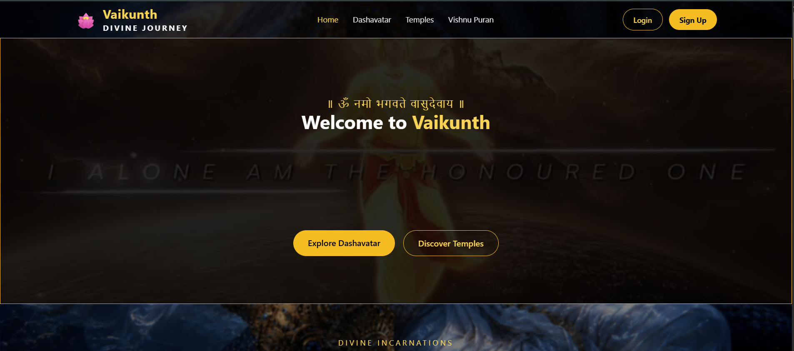

# 🪷 Vaikunth – Divine Journey

**Vaikunth** is a devotional web application dedicated to Lord Vishnu, created to explore His Dashavatar, discover sacred temples, and read fascinating stories from the Vishnu Puran.

As a devotee of Lord Vishnu, this project is my small way of dedicating my work to Him.

## 🌐 Live Demo

🔗 https://vaikunth-devine-journey.vercel.app/

## 📸 Website Preview



## ✨ Features

* 🪷 **Dashavatar:** Explore the ten avatars of Lord Vishnu.
* 🛕 **Sacred Temples:** Discover temples, explore their details, and view their locations on a map.
* 📖 **Vishnu Puran:** Read selected stories inspired by the Vishnu Puran.
* 🔐 **User Authentication:** Register and log in to your account.
* ❤️ **Favorites:** Save favorite content and access it through your profile.
* 👤 **User Profile:** Manage your profile and saved content.
* 📱 **Responsive Design:** Access the website across different screen sizes.

## 🛠️ Tech Stack

**Frontend**

* React.js
* Vite
* JavaScript (ES6+)
* HTML5
* CSS3

**Backend**

* Node.js
* Express.js

**Database**

* MongoDB
* Mongoose

**Authentication**

* JSON Web Tokens (JWT)
* bcrypt

**Deployment**

* Vercel (Frontend)
* Render (Backend)

## 📂 Project Structure

```text
Vaikunth/
├── client/       # React frontend
├── server/       # Node.js and Express backend
├── screenshots/  # Website preview
├── README.md
└── .gitignore
```

## 🎯 Project Purpose

Vaikunth was created to combine my devotion to Lord Vishnu with my interest in web development. Through this project, I have worked on building a full-stack application and applying concepts such as REST APIs, database integration, authentication, and user-specific features.

## 👨‍💻 Developer

**Anshul Gothwal**
Full Stack Developer | React.js | Node.js | Express.js | MongoDB


*Built with devotion to Lord Vishnu and a passion for learning.*
